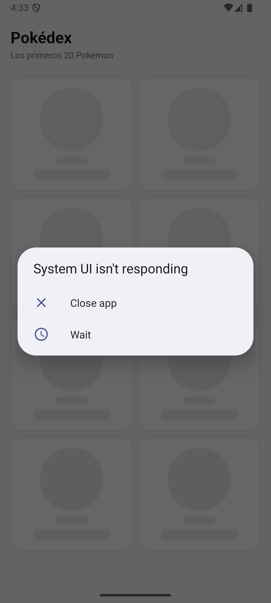
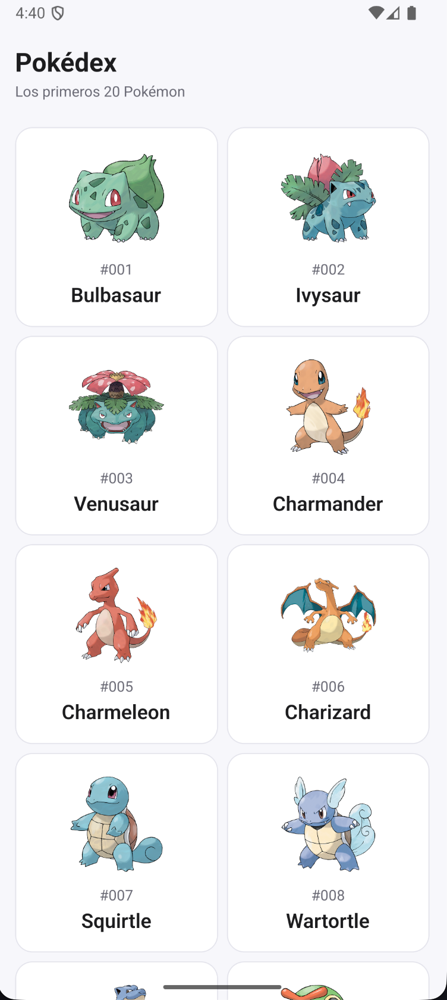
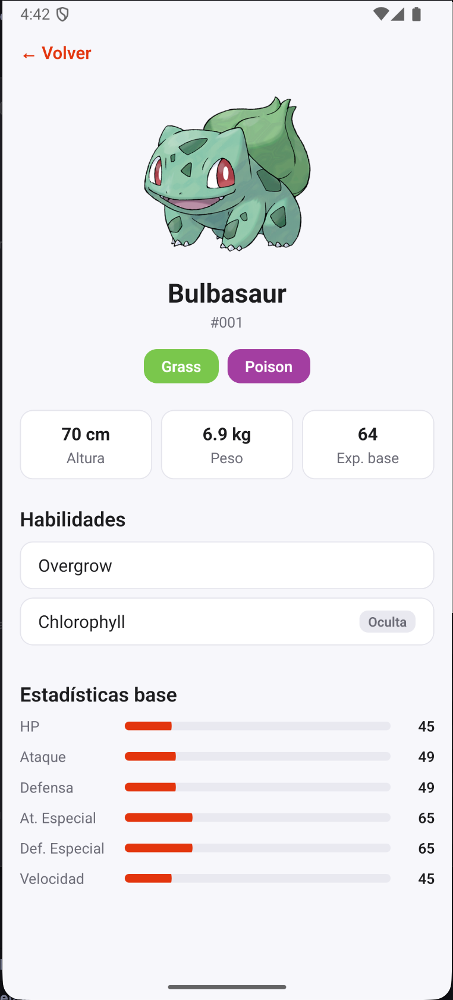

# Pokédex — React Native Challenge

Aplicación móvil que consume la API pública [PokéAPI](https://pokeapi.co/): listado de los primeros 20 Pokémon con navegación a una pantalla de detalle, construida con **Clean Architecture** y **únicamente React Native core + TypeScript** (cero librerías externas).

## Capturas

| Home (skeleton) | Home (datos) | Detalle |
| --- | --- | --- |
|  |  |  |

> Las capturas se generan al ejecutar la app (ver [Cómo ejecutar](#cómo-ejecutar)) y se guardan en `docs/screenshots/`.

## Requisitos previos

- Node.js >= 22.11.0
- Entorno de React Native configurado ([guía oficial](https://reactnative.dev/docs/set-up-your-environment)) para iOS (Xcode) y/o Android (Android Studio)

## Cómo ejecutar

```bash
npm install        # dependencias del proyecto
npm start          # arrancar Metro
```

En otra terminal:

```bash
npm run android    # emulador/dispositivo Android
```

Para iOS (primera vez), instalar CocoaPods antes de correr:

```bash
bundle install
bundle exec pod install
npm run ios        # simulador iOS
```

Verificación estática:

```bash
npm run lint       # ESLint (sin errores)
npx tsc --noEmit   # TypeScript estricto (sin errores)
```

Ejecutar test de covertura:

```
npm test -- --coverage
```

Ejecutar test unitarios:

```
npm run test
```

## Arquitectura

Clean Architecture con flujo de dependencias unidireccional hacia el dominio:

```
presentation ──> domain <── data
                    ^
                    |
        app/ (composition root: DI)
```

- **`src/domain/`** — corazón del negocio, TypeScript puro (sin React Native ni `fetch`): entidades (`PokemonSummary`, `PokemonDetail`, `PokemonStat`, `Ability`), puertos (`IApiClient`, `IStorage`, `IPokemonRepository`) y casos de uso (`GetPokemonListUseCase`, `GetPokemonDetailUseCase`).
- **`src/data/`** — implementa los puertos del dominio: `FetchApiClient` (único punto que conoce `fetch`), DTOs con la forma cruda de la API, mappers DTO→entidad (convierten dm→cm y hg→kg), `InMemoryStorage` y `PokemonRepository` con estrategia cache-first.
- **`src/presentation/`** — pantallas, componentes, hooks (`useAsync`, `usePokemonList`, `usePokemonDetail`), navegación propia y theme tokens. Solo conoce el dominio.
- **`src/app/`** — composition root: `container.ts` cablea las implementaciones concretas y `DependencyProvider` las inyecta vía Context.
- **`src/core/`** — transversal: errores tipados (`AppError`), mensajes amigables y utilidades de texto.

Flujo de una petición:

```
Screen → hook → caso de uso → repositorio → (caché | API) → mapper → entidad → UI
```

### Estructura de carpetas

```
src/
├── app/                  # composition root (DI)
├── core/                 # errores tipados, mensajes, utilidades
│   ├── errors/
│   └── utils/
├── data/                 # implementación de puertos
│   ├── api/              # FetchApiClient, endpoints
│   ├── dto/              # formas crudas de PokéAPI
│   ├── mappers/          # DTO → entidad
│   ├── repositories/     # PokemonRepository (cache-first)
│   └── storage/          # InMemoryStorage
├── domain/               # negocio puro (sin RN ni fetch)
│   ├── entities/
│   ├── ports/            # IApiClient, IStorage, IPokemonRepository
│   └── usecases/
└── presentation/
    ├── components/       # PokemonCard, TypeBadge, StatBar, Skeleton, SafeScreen
    │   └── states/       # LoadingState, ErrorState, EmptyState
    ├── hooks/            # useAsync, usePokemonList, usePokemonDetail
    ├── navigation/       # rutas tipadas, provider, AppNavigator
    ├── screens/          # HomeScreen, DetailScreen
    └── theme/            # tokens (colores, spacing, tipografía)
```

## Decisiones técnicas

1. **Cero librerías externas (restricción del reto).** Todo se resuelve con APIs de React Native core: `fetch`, `FlatList`, `Animated`, `BackHandler`, `Pressable`, `Image`, `Platform`/`StatusBar`. La dependencia `react-native-safe-area-context` incluida por el template se evita deliberadamente con un componente `SafeScreen` propio.
2. **Navigator propio tipado.** Stack de rutas en estado de React con uniones discriminadas (`switch` exhaustivo verificado por TypeScript) y soporte del botón físico de retroceso en Android vía `BackHandler`.
3. **Persistencia en memoria (trade-off).** RN core no ofrece almacenamiento persistente y el reto prohíbe librerías, por lo que la caché vive en `InMemoryStorage` mientras la app está activa. El puerto `IStorage` permite sustituirla por AsyncStorage/MMKV **sin modificar dominio ni presentación** (Dependency Inversion).
4. **Cache-first en el repositorio.** Los datos de Pokémon son estáticos: no se revalida en cada entrada, lo que da retorno instantáneo y experiencia offline parcial dentro de la sesión.
5. **Imágenes del listado sin requests extra.** El endpoint de lista no incluye sprites; el id se extrae de la URL de PokéAPI y se construye la URL del artwork oficial (convención estable del repositorio de sprites de PokeAPI).
6. **Errores centralizados.** `FetchApiClient` normaliza red/timeout/HTTP a `AppError` tipado; la UI los traduce con `getFriendlyMessage` y ofrece botón de reintento. La capa visual nunca conoce detalles de red.
7. **`useAsync` con race-condition guard.** Encapsula `data/error/isLoading/reload` para que las pantallas expresen los estados visuales exigidos (carga, error, vacío, datos) sin tocar `fetch`.

## Estados y experiencia offline (cómo verificar)

- **Carga**: skeletons con pulso animado en home y detalle.
- **Error**: apaga el wifi antes de abrir la app → mensaje amigable + botón "Reintentar".
- **Offline parcial**: carga la app una vez, activa el modo avión y navega entre el listado y detalles ya visitados → todo responde desde caché.
- **Vacío**: PokéAPI siempre devuelve datos; el estado `EmptyState` existe como defensa ante cambios del endpoint.

## Bonus implementados

- **UX**: skeleton loaders y animaciones sutiles (pulso, fade-in del detalle, barras de stats animadas), todas con `useNativeDriver: true` (hilo nativo).
- **Errores**: manejo centralizado con mensajes amigables y reintento.
- **Rendimiento**: `FlatList` virtualizada con tuning (`initialNumToRender`, `maxToRenderPerBatch`, `windowSize`), `React.memo` en tarjetas y callbacks memoizados.
- **Accesibilidad**: `accessibilityRole`/`accessibilityLabel` en elementos interactivos, estados e imágenes.
- **UI adaptable**: grid responsivo de 2/3/4 columnas según el ancho de pantalla (`useWindowDimensions`); safe areas propias en iOS y Android.
- **Calidad**: ESLint y typecheck estricto sin errores.

## Pendientes y mejoras futuras

- Persistencia real entre sesiones (AsyncStorage/MMKV) detrás del puerto `IStorage`.
- Paginación incremental (`onEndReached` de `FlatList` + `offset` en el caso de uso).
- Tests unitarios de mappers y casos de uso (los puertos permiten mocks trivialmente).
- Transiciones animadas entre pantallas y búsqueda de Pokémon.
- CI con lint + typecheck (GitHub Actions).

> Nota: el smoke test del template (`npm test`) se mantiene tal cual; no se agregaron tests unitarios por alcance de tiempo y quedan como mejora futura.
# PokemonApp
